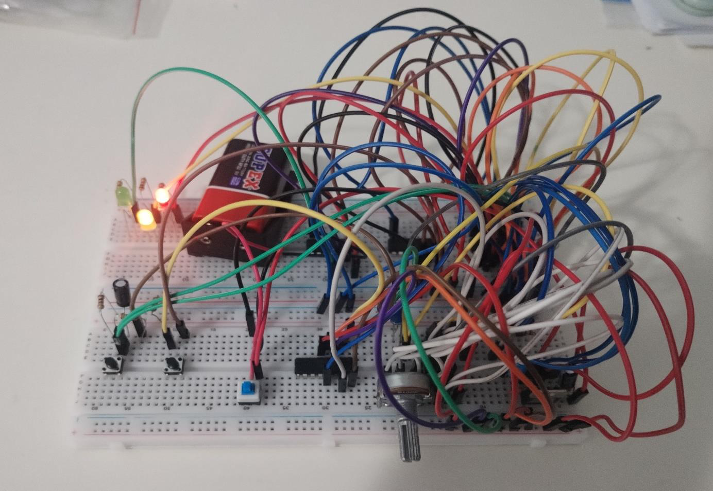
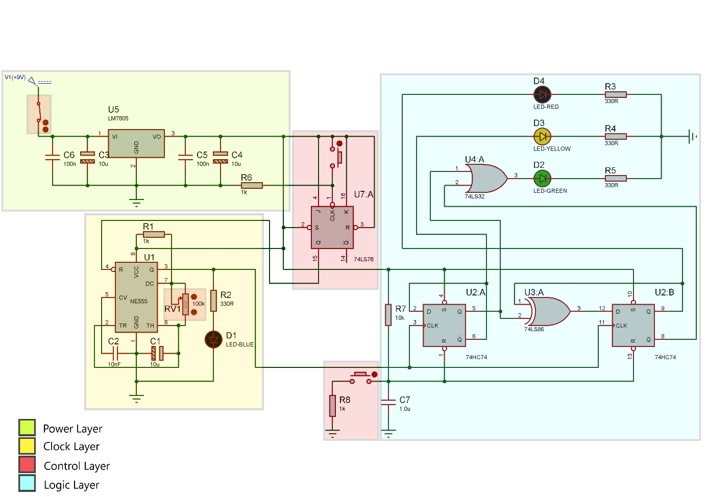
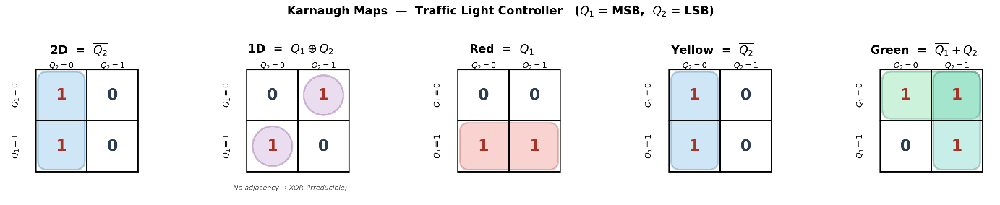
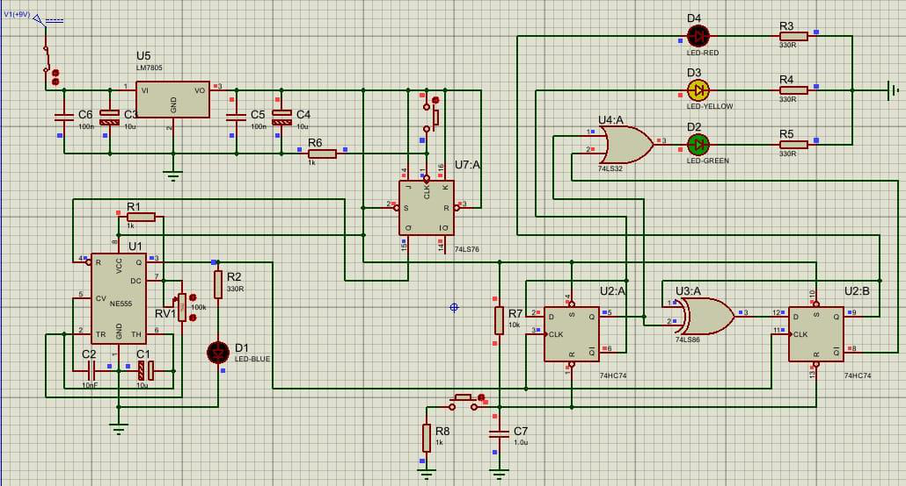
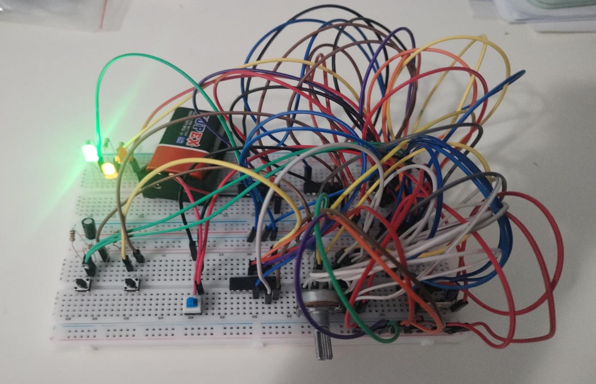
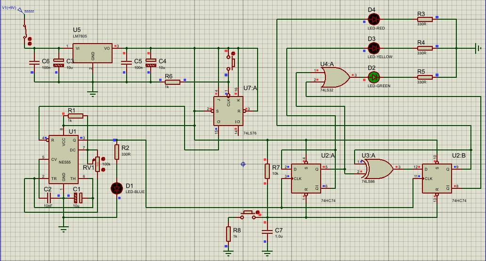
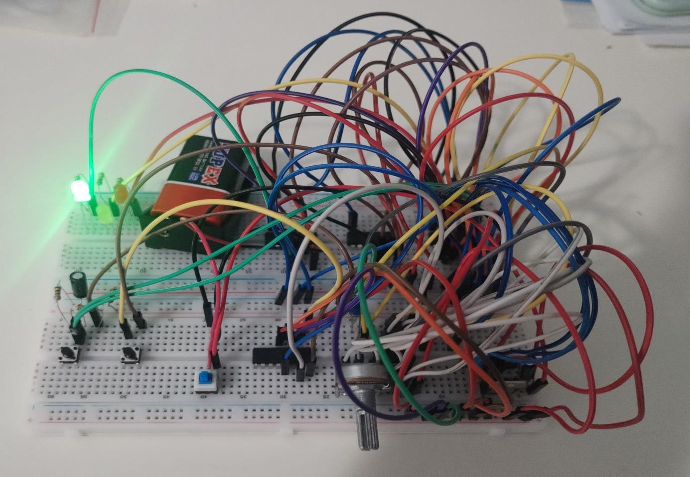
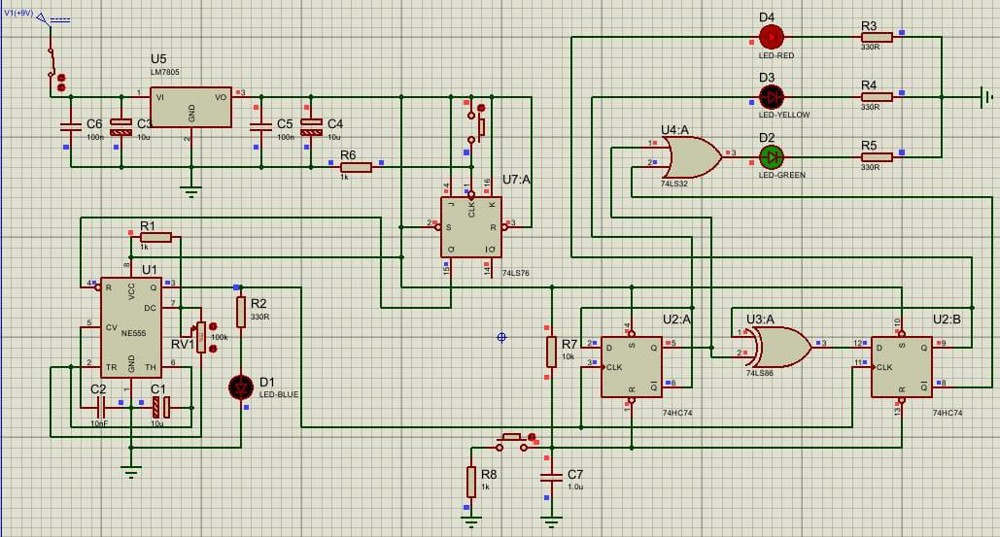
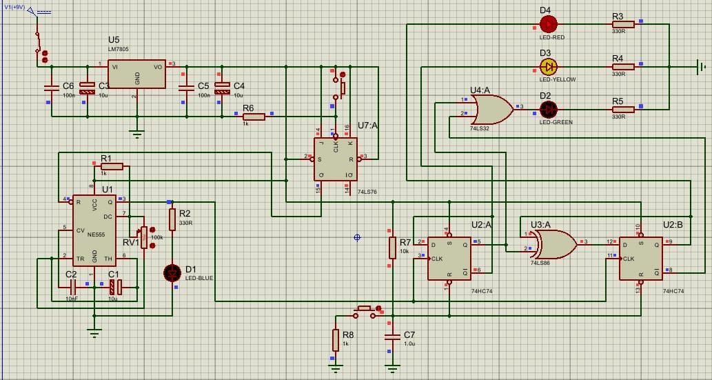
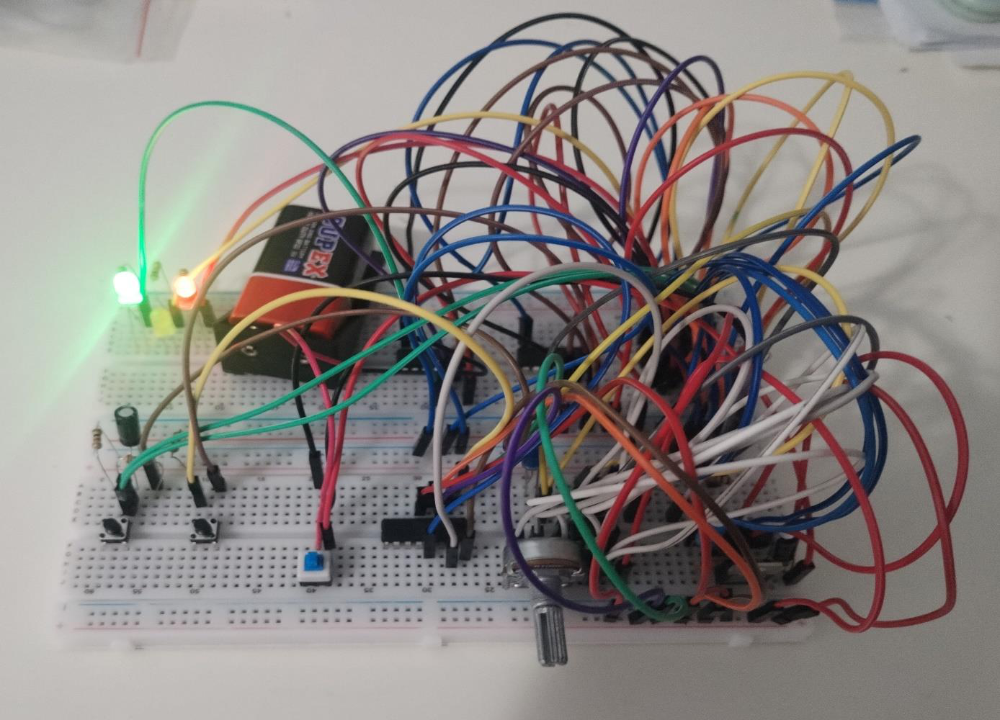

# ELM-3091 Inverse Traffic Light Controller

A hardware traffic light controller built from discrete logic for the ELM-3091
Digital Systems course project at YTU (Spring 2025/26). It is a 2-bit
synchronous Moore state machine clocked by an NE555, designed in Proteus and
built on a breadboard. The light sequence is deliberately "inverse": the LED
combinations do not follow a real traffic light.



## Circuit



The circuit has four layers:

| Layer | Parts | Role |
|-------|-------|------|
| Power | LM7805, 100 nF + 10 µF on input and output | 9 V battery to a regulated 5 V rail |
| Clock | NE555 astable, R1 = 1 kΩ, R2 = 100 kΩ pot, C1 = 10 µF | Adjustable clock, blue LED shows the pulses |
| Control | 74LS76 JK flip-flop in toggle mode + push button; RC power-on reset | Start/stop the clock through the NE555 reset pin; clear the state flip-flops at power-up or on demand |
| Logic | 2 × D flip-flop (74HC74), 74LS86 XOR, 74LS32 OR | State counter and LED decoding |

### Clock frequency

`f = 1.44 / ((R1 + 2·R2) · C1)`

| R2 | 100 kΩ | 75 kΩ | 50 kΩ | 25 kΩ | ≈ 0 Ω |
|----|--------|-------|-------|-------|-------|
| f | 0.72 Hz | ≈ 1 Hz | 1.42 Hz | 2.82 Hz | 144 Hz |

### State machine

Q1 is the MSB and Q2 the LSB. The next-state equations give a plain 2-bit
up-counter, 00 → 01 → 10 → 11 → 00:

```
D2 = Q̄2
D1 = Q1 ⊕ Q2
```

The LEDs are decoded from the state only (Moore machine):

```
Red    = Q1
Yellow = Q̄2
Green  = Q̄1 + Q2
```

| State (Q1 Q2) | Red | Yellow | Green | Lit |
|---------------|-----|--------|-------|-----|
| 00 | 0 | 1 | 1 | Yellow + Green |
| 01 | 0 | 0 | 1 | Green |
| 10 | 1 | 1 | 0 | Red + Yellow |
| 11 | 1 | 0 | 1 | Red + Green |



## Results

The simulation and the breadboard both walk through the four phases:

| Simulation | Breadboard |
|------------|------------|
|  |  |
|  |  |
|  |  |
|  |  |

## Notes

- **Debouncing:** the push buttons use a passive RC network instead of a
  Schmitt-trigger input. It works in simulation, but on the real board a
  slow RC edge without hysteresis can still let contact bounce through. A
  74HC14 between the RC network and the flip-flop inputs would fix this.
- **Logic family:** the report argues that the 74HC74 was needed because the
  74LS series cannot follow the clock edges at 144 Hz. That reasoning does not
  hold: 74LS parts work well into the MHz range, so both families are fine at
  these clock rates. Mixing the families needs care in the other direction:
  a 74LS output is only guaranteed to reach 2.7 V when high, while a 74HC
  input at 5 V needs 3.5 V, so the 74LS86 → 74HC74 connection works on the
  bench but is outside the datasheet guarantee. 74HCT parts (TTL-compatible
  inputs) would make that interface safe.
- The report text was written for the course; the corrections above take
  precedence where they differ.

## Files

- `inverse_traffic_light.pdsprj` — final Proteus project
- `history/` — earlier versions: the first state machine, the version that adds the clock start/stop control, and the 74HC74 version used for the report schematic
- `Project Report.pdf` — course report (student numbers redacted)
- `images/` — schematic, K-maps, simulation and breadboard photos

## Team

Samet Erhan Sarı, Burak Kürklü, Oğuz Esat Kurt

## Tools
Proteus 9
